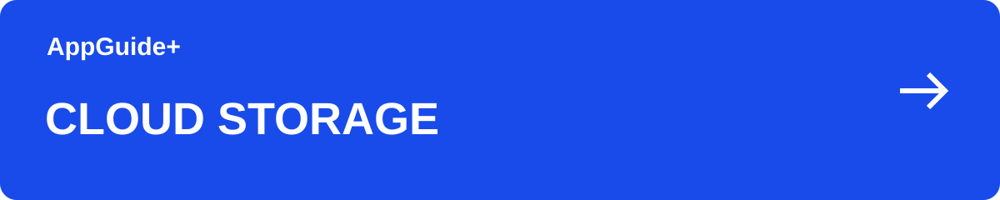

[이 분야의 안내](README.md) · [AppGuide+](https://github.com/appguideplus/app-guides#readme)

# Proton Drive 파일 공유: 보기·편집 권한과 링크 관리

파일을 전달할 때는 받는 사람이 읽기만 하면 되는지, 수정하거나 업로드해야 하는지 먼저 정하세요. 공개 링크는 전달받은 다른 사람에게도 공유될 수 있습니다.

**[웹사이트에서 안내 보기 →](https://appguideplus.com/ko/proton-drive/sharing/?utm_source=github)**

일부 웹 안내에는 제휴 링크가 포함됩니다. 해당 링크를 통한 구매·가입으로 운영자가 수수료를 받을 수 있습니다. AppGuide+는 독립 가이드입니다.

---

## 공유할 파일을 준비

전달할 파일만 별도 폴더에 정리하면 개인 자료를 함께 공유하는 실수를 줄일 수 있습니다. 업로드가 끝났는지 먼저 확인하세요.

수신자가 다운로드할 파일인지, 함께 수정할 문서인지에 맞춰 공유 방식을 고릅니다. 링크 공유와 이메일 초대는 참여자를 관리하는 방식이 다릅니다.

<strong>보기와 편집을 구분</strong>

## 보기와 편집을 구분

보기 권한은 파일 열기·다운로드, 편집 권한은 지원되는 문서 편집이나 공유 폴더 업로드 등에 영향을 줍니다. 필요한 범위만 부여하세요.

편집자가 공유 폴더에 올린 파일은 소유자의 저장 용량을 사용합니다. 공동 작업을 시작하기 전에 여유 공간도 확인하세요.

<strong>링크를 전달하기 전에</strong>

## 링크를 전달하기 전에

제공되는 비밀번호·만료 설정을 검토하고 공유 대상을 확인합니다. 링크에 접근할 수 있는 사람과 문서를 편집할 수 있는 사람을 구분하세요.

민감하지 않은 예시 파일로 수신자 관점의 접근을 확인하면 도움이 됩니다. 실제 개인정보 파일을 시험 삼아 공개하지 마세요.

<strong>공유가 끝난 뒤</strong>

## 공유가 끝난 뒤

전달이 끝났으면 기존 공유 링크를 계속 유지할지 검토합니다. 링크를 중단해도 이미 내려받은 복사본까지 회수되는 것은 아닙니다.

이메일 초대와 편집 접근에서는 공유자의 이메일이 상대에게 보일 수 있습니다. 익명으로 전달되는 방식이라고 설명하지 마세요.

<strong>함께 볼 안내</strong>

## 함께 볼 안내

- [Proton Drive 무료 용량과 유료 플랜: 파일·사진 보관 안내](proton-drive.ko.md)
- [Proton Drive 사진 백업: Android·iPhone 설정과 완료 확인](proton-drive-photo-backup.ko.md)

<strong>출처와 확인일</strong>

## 출처와 확인일

- [공유 링크와 권한](https://proton.me/support/drive-shareable-link)
- [웹에서 Drive 사용](https://proton.me/support/drive-web-guide)

내용 확인일: 2026-09-14. GitHub판 편집일: 2026-09-14.

AppGuide+가 작성한 독립적인 이용 안내이며, 각 서비스의 공식 고객지원 문서는 아닙니다.

---

[웹 안내로 이어가기](https://appguideplus.com/ko/proton-drive/sharing/?utm_source=github) · [다른 안내 고르기](README.md)

읽기 구성 정리: 2026-10-23.
